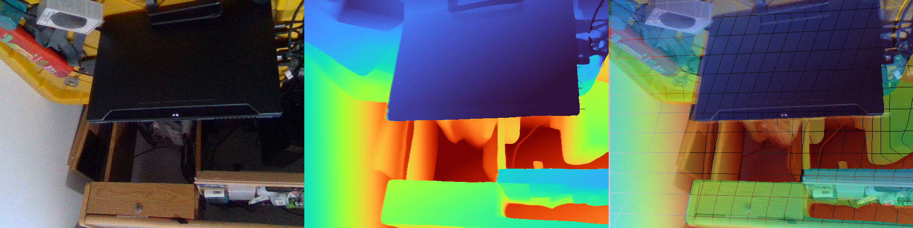

# deephpose

Profundidad estéreo densa con **FoundationStereo** (ViT-small `11-33-40`) sobre
pares IR de una **RealSense D415**, comparada con la profundidad original de la
cámara, proyectada a RGB y en vivo. Rumbo a **estimación de pose**.

| | |
|---|---|
| Plataforma | Windows 11 nativo (sin WSL / Conda / Docker) |
| GPU | RTX 4070 Laptop 8 GB · driver 591.74 |
| Python | 3.11 64-bit, gestionado con `uv` (`pyproject.toml` + `uv.lock`) |
| Cámara | D415 por USB 3.0 · 640×480@30 · IR1+IR2+depth+color |

## Instalación

```powershell
uv python pin 3.11
uv sync
```

- `torch 2.6.0+cu124` / `torchvision 0.21.0` / `xformers 0.0.29` desde el índice
  oficial de PyTorch (fijado en `pyproject.toml`, receta Windows del issue #219).
- `flash-attn` 2.8.3: wheel de terceros `kingbri1/flash-attention`
  (`cu124+torch2.6.0+cp311`, fijado en `uv.lock`). Sin adaptaciones de
  atención: el código FS no importa `flash` directamente.
- Un solo OpenCV: `opencv-contrib-python`.
- Pesos en `pretrained_models/11-33-40/` (`cfg.yaml` + `model_best_bp2.pth`,
  787 MB, Drive oficial — no van al repo). FoundationStereo clonado sin
  modificar en `third_party/` (`6e88068`); solo se adapta
  `torch.load(weights_only=False)` en nuestro wrapper (torch 2.6 cambió el
  default y el checkpoint es de 2025). Con red, timm/dinov2 bajan solos de HF.

## Uso

Todo corre desde la raíz. `config.toml` centraliza defaults (el CLI gana).

```powershell
# Pares estáticos
uv run python scripts/capture.py --emitter on          # data/raw/<sello>_emitter-on/
uv run python scripts/infer.py --capture data/raw/<sello>_emitter-on
uv run python scripts/project_to_rgb.py --fs data/processed/<sello>_fs --capture data/raw/<sello>
uv run python scripts/evaluate.py --fs data/processed/<sello>_fs --capture data/raw/<sello>

# En vivo (s=guardar, q=salir; --view both|fs|d415, --zoom, --scale, --valid-iters)
uv run python scripts/live.py --emitter on

# Demo oficial intacta
uv run python scripts/run_official_demo.py --scale 1
```

Cada captura guarda `left.png`, `right.png`, `color.png`,
`depth_original.npy` (uint16 intacto), `calibration.json` (intrínsecos IR+RGB,
extrínseco IR-izq→RGB, baseline real, depth scale) y `metadata.json`.

## Resultados medidos

`640×480, valid_iters=16, VRAM libre`: `t_load≈2.6 s`, `t_infer≈0.64 s`,
`vram≈1646 MiB`, AMP válida. Demo oficial 960×540 en 9.4 s.

| Escena | MAE FS↔D415 | Mediana | Válido conjunto |
|---|---|---|---|
| Emisor ON | 11.5 mm | 2.1 mm | 86.6% |
| Emisor OFF | 51.7 mm | 11.6 mm | 44.8% |

El emisor aporta **cobertura** D415, no precisión FS. D415 = comparación, no
ground truth. Figuras en `reports/figures/`, números en
`data/processed/*_eval/metrics.json`.



## Estructura

```
scripts/          capture, infer, live, evaluate, disparity_to_depth, project_to_rgb, fs_model, config
config.toml       defaults centrales
data/raw/         capturas inmutables (no va al repo)
data/processed/   disparidad, profundidad, nubes, evals (no va al repo)
notebooks/        marimo (03-compara pendiente)
reports/figures/  figuras versionadas
pretrained_models/  pesos (no van al repo)
third_party/      FoundationStereo intacto (no va al repo)
```

## Limitaciones y pendientes

- Con otro proceso en GPU, escala 1.0 murió sin traceback (~7.4/8 GB): medir
  siempre con VRAM libre; si falta, `--scale 0.5`.
- Sin Triton en Windows (aviso xformers benigno, no instalado por innecesario).
- Falta: exactitud absoluta con distancia conocida, repetibilidad controlada,
  validación en piezas (poca textura, bordes, reflejos) y notebook marimo.
- Siguiente fase: estimación de pose sobre la nube coloreada.

## Benchmark reproducible de pose

Para comparar iteraciones sobre los mismos frames de una grabación RealSense,
usa la ruta offline documentada en [pose/REPLAY.md](pose/REPLAY.md).
`scripts/prepare_replay.py` congela imágenes y profundidad;
`pose/benchmark_replay.py` compara 1/2/5 iteraciones desde la misma pose inicial,
con métricas y overlays por variante. Los tiempos de tracking offline se
reportan separados de los FPS del modo vivo.

Configuración de pose evaluada sobre la grabación del ratón (escala 0.5,
FS con 8 iteraciones y tracking con 5):

```powershell
uv run --project pose python pose/live_pose.py --mesh data/mesh/mouse/910-007575_MX_MASTER_4_MAC_Space_Black_prepared.obj --scale 0.5 --valid-iters 8 --track-iters 5 --mask-text 'computer mouse' --bag data/bags/live_20261010_030134.db3
```

Omitir `--bag` para cámara. El vivo usa IPC binario en memoria y un solo
render CAD por pose. Los defaults numéricos se conservan; el comando fija
explícitamente la configuración evaluada. El A/B de rendimiento se ejecuta
sin ventana y con inicialización común; no mide arranque ni exactitud absoluta.

La ampliación del benchmark validó también `--valid-iters 4`, manteniendo
`--scale 0.5 --track-iters 5`: 3.61 frente a 3.33 poses/s de FS8 en el A/B
contemporáneo (+8.6%), sin LOST. Incluye una segunda grabación y pruebas
con cámara/ventana. Véase [validación y perfil por etapas](reports/validacion_fs4_camara_20261010.md)
para diferencias de pose, latencia y límites de estas dos secuencias.

La proyección usa ahora un z-buffer sin doble ordenamiento, conservando
profundidad e índices ganadores. Está activo por defecto y no requiere
dependencias nuevas; `--sorted-zbuffer` conserva la referencia para A/B.
Con FS4, el A/B del z-buffer dio 3.49 → 4.00 poses/s (+14.5%), sin LOST;
la proyección coincidió exactamente en 161 frames fijos.
Véase [equivalencia y rendimiento del z-buffer](reports/optimizacion_zbuffer_20261010.md).

La ventana muestra ahora el RGB rectificado correspondiente a cada pose,
sin superponer estimaciones antiguas sobre video más reciente. Se conserva
escala 0.5 como recomendación: 0.4 fue más rápida, pero perdió robustez en el
ensayo de frames fijos. [Perfil interno, escalas y display](reports/escala_fs_display_20261010.md).

La construcción de volúmenes de FoundationStereo reutiliza la normalización y
vectoriza la concatenación. Está activa por defecto: 161 disparidades idénticas
y 3.50 → 3.72 poses/s (+6.2%) en cuatro pasadas contemporáneas, sin LOST en
1,170 resultados. Se mantienen escala 0.5, FS4 y tracking5; el comando habitual
no cambia. `--reference-volumes` permite repetir la versión anterior.
[Equivalencia y benchmark de volúmenes](reports/optimizacion_volumenes_fs_20261010.md).

El vivo también omite la nube auxiliar de proyección y dibuja los ejes opacos
directamente en RGB. Conserva salidas exactas en 161 frames: en el A/B de esta
optimización pasó de 3.91 a 4.36 poses/s (+11.6%) y de 492 a 427 ms de latencia
mediana, sin LOST en 1,342 poses. Se activa sin cambiar el comando; `--reference-cpu`
permite comparar la proyección detallada y los ejes anteriores.
[Resultados de proyección y overlay](reports/optimizacion_proyeccion_overlay_20261010.md).

El tracking reutiliza la rejilla de recorte RGB/XYZ, mantiene la pose en GPU y
conserva la caché CUDA entre llamadas. En el A/B pasó de 166.6 a 148.6 ms de
tracking y de 430 a 411 ms de latencia; los FPS permanecieron alrededor de 4.3.
Cuatro secuencias fijas produjeron poses exactamente iguales y no hubo LOST en
1,397 poses concurrentes. Las cinco iteraciones y el registro inicial se conservan.
`--reference-tracking` permite repetir el camino original.
[Perfil y validación del tracking](reports/optimizacion_tracking_20261010.md).

Durante SAM y el registro inicial se pausan nuevas inferencias de profundidad,
liberando la GPU para inicializar la pose. El registro conserva 252 orientaciones
y cinco iteraciones; comparte la geometría de los recortes RGB/XYZ. En un A/B
con profundidad concurrente sobre IR grabado, el registro pasó de 19.29 a 8.45 s
de media (dos muestras por variante, con variabilidad considerable). No incluye
la carga de SAM. `--reference-init` permite comparar el comportamiento anterior.
[Mediciones y límites de la optimización de INIT](reports/optimizacion_init_20261010.md).

Para priorizar el tiempo de inicialización, añadir `--fast-init` al comando de
cámara. Es experimental: precarga y conserva SAM, prepara los kernels de pose y
busca 42 orientaciones, refinando las ocho mejores hasta completar cinco
iteraciones. Si el ajuste de profundidad o máscara es malo, vuelve a la búsqueda
completa. La preparación de modelos sigue tardando varios segundos; el objetivo
de aproximadamente un segundo se refiere a SAM + registro después de preparar
los modelos y disponer del frame RGB-D. La pose puede diferir de la búsqueda
completa. [Benchmark y límites del modo rápido](reports/init_un_segundo_20261010.md).

EfficientSAM3 EV-M está disponible de forma experimental con
`--sam-backend efficientsam3` (recomendado junto a `--fast-init`). Corre en otro
proceso y un entorno aislado. En 21 frames tardó 0.156 s por imagen frente a
0.368 s de SAM3, pero devolvió máscaras en 18/21 frente a 20/21, usando un
umbral experimental de 0.1. SAM 3.1 es ahora el predeterminado del vivo;
`--sam-backend sam3` conserva la opción anterior.
[Instalación](experiments/efficientsam3/README.md) y
[calidad, memoria y prueba integrada](reports/efficientsam3_20261011.md).

Con `--mask-text`, el vivo recupera automáticamente tras tres poses inválidas
consecutivas: busca con SAM en segundo plano, registra la nueva máscara y valida
la pose en un frame capturado después del registro. Durante la búsqueda y el
registro la ventana muestra la cámara actual sin superponer una pose antigua.
`--no-auto-recover` desactiva la recuperación; `--recovery-lost-frames` y
`--recovery-retry-s` ajustan el disparo y la espera entre búsquedas.
Esto no aumenta por sí solo la frecuencia de FoundationPose.

La caja y los ejes visuales se alinean al plano dominante de la malla. En el
MX Master corrige los 18° entre la base y los ejes del OBJ, manteniendo intacta
la pose estimada. Las mallas sin una superficie plana suficientemente grande
conservan su caja original. [Comparación visual](reports/base_aligned_box_20261011/comparison.jpg).

[SAM 3.1](experiments/sam31/README.md): código y pesos oficiales en otro entorno.
El vivo usa un worker residente para máscaras de inicio y recuperación, y
FoundationPose para tracking 6D. El benchmark temporal se ejecuta por separado.
Durante la búsqueda de recuperación con SAM 3.1, profundidad y pose ceden la GPU;
la captura y la ventana continúan. Esto evita saturar la VRAM de 8 GiB.
[Prueba integrada y comando de cámara](reports/sam31_default_20261011.md).

El vivo superpone el modelo 3D con sus colores, a una opacidad de 0.65.
`--overlay-alpha 1` lo hace opaco; `--overlay-alpha 0.3` deja ver más la cámara.
`--overlay silhouette` recupera la silueta roja. Color y profundidad del CAD
se calculan en una sola pasada, compartida con las métricas de ajuste.
