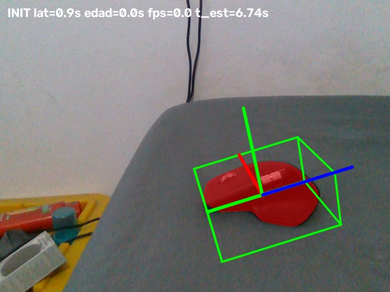
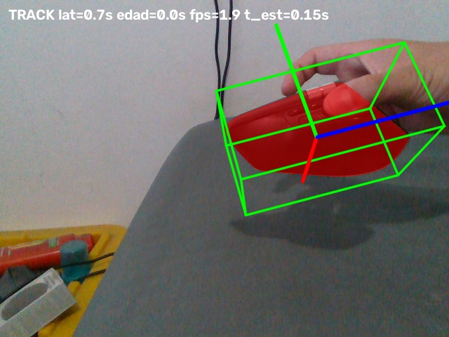
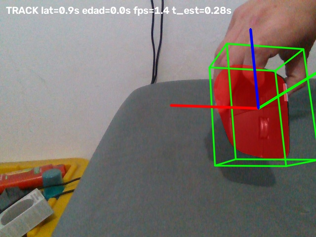

# Benchmark del video live_20261010_030134.db3

Fecha de evaluación: 2026-10-10. GPU RTX 4070 Laptop 8 GB.

## Entrada y configuración

Grabación RealSense SQLite de 2,866,073,600 bytes: 2,470 imágenes por stream (IR1, IR2, profundidad y color), aproximadamente 83.18 segundos. Consultada en modo solo lectura. No se abrió la cámara ni se alteró la grabación.

Comando base ejecutado:

```powershell
uv run --project pose python pose/live_pose.py --mesh data/mesh/mouse/910-007575_MX_MASTER_4_MAC_Space_Black_prepared.obj --scale 0.5 --mask-text 'computer mouse' --bag data/bags/live_20261010_030134.db3 --track-iters 5
```

Defaults efectivos: FS valid_iters=16, registro=5 iteraciones, warmup=60 frames, 640×480 a 30 FPS de entrada. SAM por texto. No se cambió la lógica ni los parámetros para optimizar.

SHA256 de live_pose.py durante las ejecuciones: `283dcb383bc9222b96873426a2098f98d7a6a6ad560c518ae5d8874eb5426d6a`.

## Resultados de las dos pasadas

| Métrica | A: comando original | B: misma aplicación con observador |
|---|---:|---:|
| Resultados totales, incluido INIT | 83 | 106 |
| TRACK / LOST, excluido INIT | 5 / 77 | 105 / 0 |
| Porcentaje LOST | 93.90% | 0% |
| Frecuencia efectiva de actualizaciones | ~1.81 Hz | 1.786 Hz |
| Mediana FPS instantáneos del HUD | 1.9 | 1.874 |
| Pose tracking, mediana | 160 ms | 163 ms |
| Pose tracking, p95 | ~230 ms | 289 ms |
| Latencia HUD antes de overlay, mediana | 700 ms | 716 ms |
| Latencia HUD antes de overlay, p95 | 900 ms | 973 ms |
| Registro inicial, solo estimate_pose | 5.35 s | 6.737 s |

A usa el log original, con tiempos redondeados. Su frecuencia efectiva se aproxima como N/suma(1/FPS registrado), excluyendo INIT. B usa diferencias de tiempo de publicación sin redondear. No usar la media aritmética de los FPS instantáneos como throughput.

El observador B intercepta únicamente la impresión de resultados: guarda JSONL y un JPEG del overlay aproximadamente cada 5 segundos. No altera captura, colas, modelos, inicialización, LOST ni reproducción. Tiene costo de observación/I/O, por lo que no es una repetición estrictamente idéntica de A. Ambas pasadas cerraron normalmente al terminar el archivo. No se debe atribuir la diferencia de calidad al observador ni a una optimización: no se hizo ninguna.

## Detalle medido en B

- FS, tiempo de modelo: mediana **365 ms**, p95 **456 ms**.
- Tracking FoundationPose, 5 iteraciones: mediana **163 ms**, p95 **289 ms**.
- Recepción del frame en grab → publicación de pose/overlay: mediana **788 ms**, p95 **1,082 ms**, máximo **2,975 ms**. No es latencia sensor→pantalla: no incluye exposición ni presentación final de OpenCV.
- Espera antes de FS: mediana **16.7 ms**, p95 **41.5 ms**.
- Primera publicación INIT a **30.86 s** desde el inicio del runner (incluye imports/carga/SAM/registro); proceso completo **98.62 s**, incluido cierre y detección de EOF.
- Bundle evaluado al publicar INIT: frame IR **727**; último bundle: **2465**. Intervalo de timestamps entre ambos: **58.39 s**. La pose INIT proviene de un bundle anterior por el funcionamiento asíncrono actual, por lo que 727 no identifica exactamente el frame usado en register.
- Residuo geométrico mediano de las salidas posteriores a INIT: **2.1 mm**, p95 **4.64 mm**; cobertura mediana **93.5%**.

Estos residuos comparan la malla estimada con la profundidad usada por el algoritmo; no son error contra ground truth. TRACK también es una clasificación interna, no garantía de pose exacta. Las medianas de etapas no deben sumarse para reconstruir latencia porque las etapas se solapan y las distribuciones difieren.

## Lo observado en las imágenes

Revisados los overlays de los resultados 1, 29, 58, 77 y 104 de B. En esas muestras la caja y el CAD acompañan al ratón sobre la mesa, con mano alrededor, levantado y girado. No hay una divergencia evidente como la sugerida por los grandes residuos de A; la revisión de muestras no prueba exactitud en todos los frames.

Los JPEG contienen `draw_overlay` sobre el frame rectificado correspondiente al bundle procesado. No son capturas de la ventana: la ventana de la aplicación puede mostrar la caja de esa pose sobre RGB más reciente. Por tanto, las imágenes sirven para inspeccionar ajuste espacial, mientras la telemetría cuantifica el retraso.





## Hallazgo principal para futuras comparaciones

La velocidad se mantiene alrededor de **1.8 poses/s**, pero la estabilidad es muy sensible a la ejecución. A pierde el objeto en la séptima salida: el residuo pasa de 4.8 mm a 106.4 mm y permanece LOST hasta el final; B conserva TRACK en sus 105 actualizaciones posteriores a INIT.

El código reproduce en tiempo real y conserva solo frames recientes. El archivo comienza a avanzar antes de terminar la carga/inicialización; los frames elegidos dependen del tiempo de arranque y del scheduling. Además, SAM y register no mantienen asociado su bundle hasta la aplicación/evaluación del resultado. Son mecanismos concretos capaces de alterar el inicio y el seguimiento; estas dos pasadas no permiten aislar cuál causó la diferencia observada. También pueden intervenir carga GPU y variación numérica.

Este resultado es una **línea base operativa**, no todavía un benchmark determinista de exactitud. Para comparar cambios justamente:

1. Mantener este modo real-time para medir latencia, frecuencia y descarte de frames.
2. Añadir un modo de replay controlado que pause la entrada durante carga/SAM/registro y conserve el mismo frame para máscara, profundidad y pose.
3. Para comparar precisión, seleccionar idénticos números de frame o una política de muestreo fija en cada variante. Procesar todos los frames offline cambia la dificultad temporal respecto al vivo: reportar ambos modos por separado.
4. Comparar track_iters=1/2/5 y valid_iters=4/8/16 sobre la misma secuencia, registrando LOST, recuperación, residuos y revisión visual, además de tiempo. Esta evaluación solo ejecutó track_iters=5 y valid_iters=16.

## Archivos de evidencia

- `bag_baseline_20261010_track5.log`: salida íntegra A.
- `bag_baseline_20261010_summary.json`: métricas y resultados A.
- `bag_baseline_20261010_metadata.json`: inventario de topics, conteos y tiempos de la grabación.
- `bag_baseline_20261010_observed.log`: salida íntegra B.
- `bag_baseline_track5_observed/frames.jsonl`: por resultado, tiempos precisos, IDs/timestamps, pose 4×4 y ajuste.
- `bag_baseline_track5_observed/summary.json`: métricas B.
- `bag_baseline_track5_observed/manifest.json`: argumentos y hash del código B.
- `run_bag_baseline.py`: observador reproducible; rechaza sobrescribir evidencia previa.

Se añadieron solamente archivos de evaluación en reports/. No se modificó live_pose.py ni se aplicaron optimizaciones.
