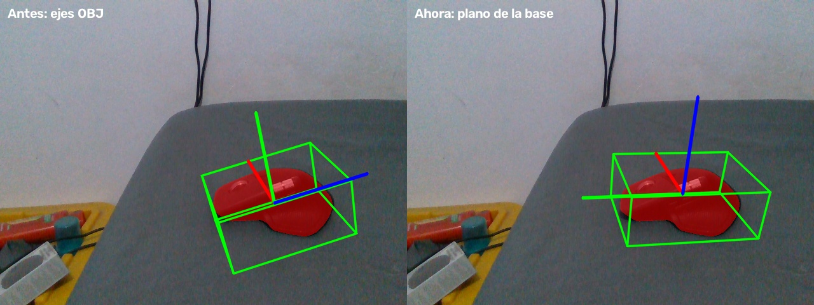

# Caja alineada con la base del mouse

La caja anterior usaba el AABB en los ejes originales del OBJ. El plano inferior
dominante del MX Master está inclinado **18.0002°** respecto al eje Y de ese OBJ;
por ello la caja no seguía la base aunque la silueta del CAD ajustara bien.

`pose/mesh_box.py` obtiene la normal por SVD sobre el mayor facet planar, orienta
Z hacia el cuerpo y proyecta un eje original sobre ese plano para definir X/Y.
Calcula mínimos/máximos de todos los vértices en esas coordenadas, de modo que
la caja contiene la malla entera. No fuerza horizontalidad en la imagen: la caja
rota junto al objeto. Para esta malla el plano ocupa 8.78% del área superficial;
las mallas sin facet de al menos 5% conservan el AABB anterior.

La caja y los ejes de visualización usan `pose @ box.to_object`. La malla, su
origen y la pose que FoundationPose calcula/exporta no se modifican. El eje Z
azul ahora es normal al plano; los ejes se centran en la nueva caja.

Dimensiones de la caja alineada: **88.31 × 128.10 × 50.78 mm**. Son medidas de
la malla, no una medición nueva del objeto físico. Se calcula una vez al crear
el estimador y no hace SVD por frame.

La comparación usa el frame 60 del replay FS4 y la misma pose guardada; comparte
un único render de profundidad para ambas imágenes. Se inspeccionó visualmente
el resultado. Código reproducible: `pose/validate_mesh_box.py`; geometría medida:
`base_aligned_box_20261011/geometry.json`.

Pasaron seis pruebas de geometría y proyección/overlay: normal de base de una
caja rotada, contención y transformación reversible de vértices, ausencia de
mutación del mesh/pose, fallback para una esfera, transformación coherente de
caja/ejes y reutilización del render. No evalúan precisión absoluta de la pose.
