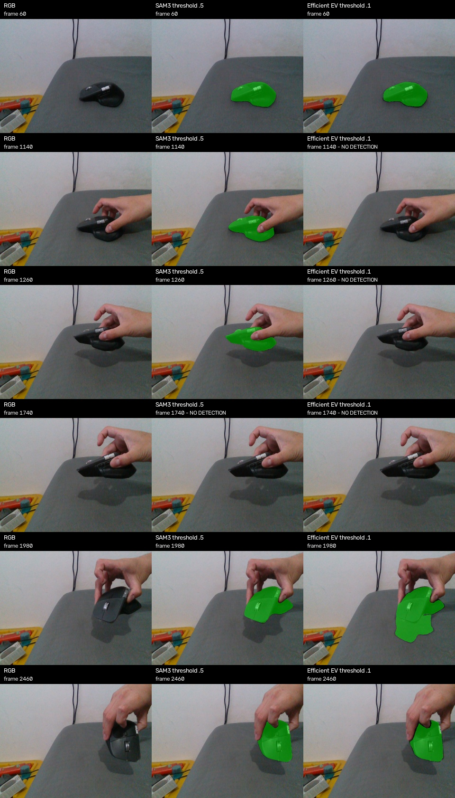

# EfficientSAM3: instalación y evaluación, 11 de octubre de 2026

Instalado y disponible como backend opcional. EV-M reduce el coste de
segmentación y memoria, pero devuelve máscaras en menos frames que SAM3. TV-M
fue más rápido en esta prueba, con menos detecciones todavía. SAM3 sigue siendo
el predeterminado; para probar EV-M, añadir `--sam-backend efficientsam3` al
comando habitual con `--fast-init`.

## Comparación de máscaras

Grabación `live_20261010_030134.db3`, bundles FS4 congelados a escala 0.5,
21 frames distribuidos desde 60 hasta 2460 y dos repeticiones por frame.
RTX 4070 Laptop 8 GB. Dos calentamientos previos. Texto idéntico:
`computer mouse`; resolución de entrada de ambos modelos: 1008.

| Backend | Umbral | Media por imagen | Frames con máscara | Pico de memoria asignada por PyTorch |
|---|---:|---:|---:|---:|
| SAM3 actual | 0.5 | 0.368 s | 20/21 | 1,992 MiB |
| EfficientSAM3 EV-M | 0.5 | 0.172 s | 0/21 | 1,099 MiB |
| EfficientSAM3 EV-M | 0.2 | 0.210 s | 9/21 | 1,099 MiB |
| EfficientSAM3 EV-M | 0.1 | 0.156 s | 18/21 | 1,099 MiB |
| EfficientSAM3 TV-M | 0.5 | 0.199 s | 0/21 | 1,147 MiB |
| EfficientSAM3 TV-M | 0.1 | 0.111 s | 12/21 | 1,147 MiB |

EV-M a 0.1 redujo el tiempo medio observado un 57.4% y el pico de memoria
asignada un 44.8% frente al SAM3 actual. La memoria asignada no incluye el
contexto CUDA, memoria reservada sin usar, FS ni FoundationPose. En el vivo
EfficientSAM3 usa otro proceso, cuyo contexto también consume recursos.

Las pasadas fueron secuenciales, no un A/B intercalado. Los entornos difieren:
SAM3 usa Python 3.11, Torch 2.6/CUDA 12.4 y pesos BF16; EfficientSAM3 usa
Python 3.12, Torch 2.7.1/CUDA 12.6, pesos FP32 y autocast BF16. Los tiempos
comparan implementaciones disponibles en este equipo, no solo arquitecturas.
La variación entre pasadas impide atribuir al umbral todos los cambios de tiempo.

## Umbral y calidad

EV-M producía una máscara útil en el primer frame con score 0.249, que el umbral
0.5 descartaba. En FP32 el score fue 0.248 y el resultado similar, por lo que ese
fallo no se resolvió cambiando precisión. Se probaron seis textos: algunos
seleccionaban la mesa en lugar del ratón. Se mantuvo `computer mouse`.

El umbral 0.1 es experimental y se escogió mirando esta grabación; no existe
validación independiente de su calibración ni prueba exhaustiva de falsos
positivos con el objeto ausente. Los scores de modelos diferentes no se deben
interpretar como probabilidades comparables.

EV-M perdió detecciones en los frames 1140, 1260 y 1740; SAM3 solo en 1740.
En los 18 frames compartidos, las máscaras suelen coincidir bien, pero el IoU
en el frame 1980 cayó a 0.588: EV incluyó parte de la superficie bajo el ratón.
Esto limita su fiabilidad con manos, inclinación y oclusión.

## Efecto en FoundationPose

Se compararon las máscaras de SAM3 y EV-M en los 18 frames donde ambos
devolvieron resultado. Mismo estimador, profundidad, registro rápido de 42
orientaciones, ocho finalistas y cinco iteraciones. Diferencias frente a la pose
obtenida con la máscara de SAM3:

- Traslación: mediana 0.85 mm; máximo 2.47 mm.
- Rotación: mediana 0.25°; máximo 0.75°.
- Ningún fallback del registro rápido en esas 18 inicializaciones.
- 51 pasos posteriores de tracking, sin cumplir los criterios de LOST.

No son errores frente a ground truth. Se excluyen de esta comparación las
inicializaciones sin máscara, que son precisamente una desventaja de EV.
La estabilidad del tracking no implica que todos los contornos sean correctos.

## Prueba integrada con ventana

EV-M inicializó y completó 20 poses (INIT y 19 TRACK), sin LOST:
SAM 0.270 s, registro 0.873 s, total de ambas fases con coordinación 1.195 s.
La preparación de SAM fue 11.85 s. No se obtuvo un arranque completo de un
segundo: la primera pose apareció a los 126 s del script en esta pasada.

La prueba previa de SAM3 había dado 0.979 s para SAM + registro, con un estado
del equipo distinto. Estas dos pasadas no demuestran una mejora del tiempo
total, ni de FPS de tracking. SAM solamente se usa al inicializar o reinicializar.

## Instalación y reproducción

Se mantuvo separado el entorno existente. Fuente:
[EfficientSAM3](https://github.com/SimonZeng7108/efficientsam3), commit
`bd0936c788fed8d51fa799437f05abd97b401b06`; pesos del
[repositorio de modelos](https://huggingface.co/Simon7108528/EfficientSAM3),
revisión `85b05896928f974e308f889d7ccb2eefc069de98`.

La carga usa `strict=True` y no deja capas sin pesos. El checkpoint EV publicado
corresponde al backbone B1. El conteo real de parámetros cargados fue 97.44 M
para EV y 103.53 M para TV, distinto de la tabla resumida del README upstream.
Los hashes SHA256 de pesos y el commit están en cada resultado de benchmark.
No se modificaron archivos del repositorio externo ni se instaló MobileSAM.

Se comprobaron compatibilidad de dependencias, seis pruebas de selección de
backend/protocolo/errores de SAM y la ejecución real del worker y su cierre.
Comandos de instalación y ejecución en
[experiments/efficientsam3/README.md](../experiments/efficientsam3/README.md).

Evidencia:

- [Resumen de segmentación y memoria](efficientsam3_comparison_20261011/summary.json).
- [Diagnóstico de textos y precisión](efficientsam3_ev_diagnostic_20261011/summary.json).
- [Comparación de poses](efficientsam3_pose_20261011/summary.json).
- [Telemetría integrada](efficientsam3_live_20261011.jsonl).
- [Log integrado](efficientsam3_live_20261011.log).
