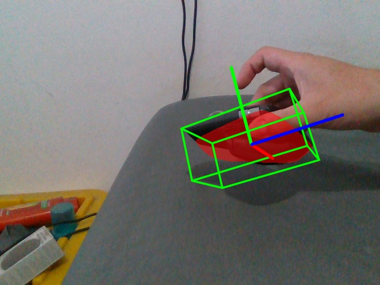
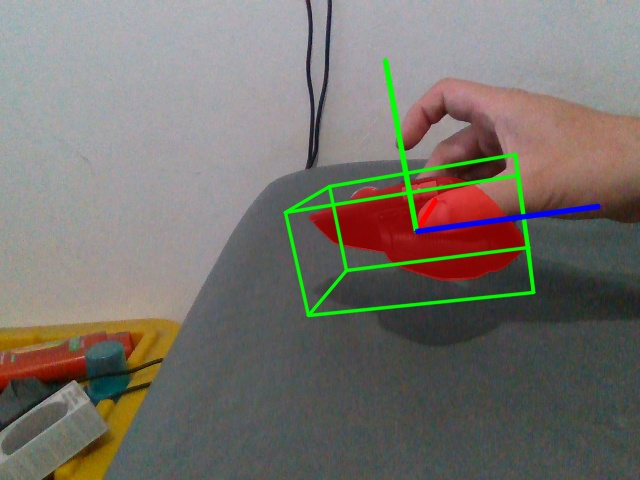
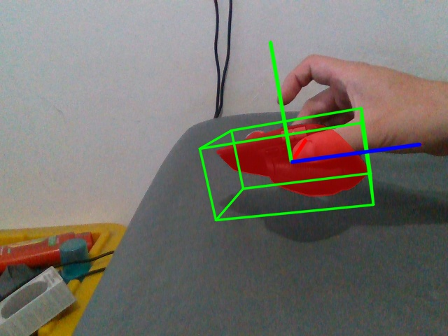

# Replay controlado: comparación de 1, 2 y 5 iteraciones

## Resultado

La comparación ya usa **los mismos frames, profundidad, máscara y pose inicial**.
Dos rondas, 1→2→5 y 5→2→1, produjeron las mismas poses (diferencia máxima entre
matrices: 0) y estados para cada variante en este entorno. Esto comprueba la
repetibilidad observada de esta secuencia, no garantiza determinismo bit a bit
en otro hardware o versión.

| Iteraciones de tracking | Mediana | p95 | LOST por ronda | Residuo mediano | Residuo p95 |
|---|---:|---:|---:|---:|---:|
| 1 | 18.8 ms | 23.9 ms | 7 / 160 | 2.2 mm | 5.25 mm |
| 2 | 29.7 ms | 35.7 ms | 1 / 160 | 2.2 mm | 4.64 mm |
| 5 | 65.4 ms | 75.3 ms | 0 / 160 | 2.2 mm | 4.41 mm |

Tiempos agregados de ambas rondas, medidos con sincronización CUDA en
track_pose. **Solo tracking offline**: excluyen FS, carga de archivos,
métricas, visualización e I/O de resultados. FS tampoco compite por GPU.
No son FPS de la aplicación en vivo.

## Interpretación

- **5 iteraciones:** mejor estabilidad de las opciones probadas; ningún LOST.
- **2 iteraciones:** reduce el tiempo mediano de tracking un **54.6%** frente
  a 5, con una pérdida puntual en el frame 1230; recupera TRACK en 1245 sin
  registro global. Buen candidato si se acepta ese compromiso.
- **1 iteración:** más rápida pero pierde siete actualizaciones consecutivas,
  frames 1230–1320 (paso 15); vuelve a TRACK en 1335. No la elegiría como
  configuración general para este movimiento.
- Se conserva 5 como referencia de estabilidad; no se cambiaron los defaults
  de live_pose. Antes de adoptar 2 en vivo, comprobarlo con FS concurrente.

La mediana global de residuos es igual entre variantes y oculta el tramo de
pérdida. Por eso se reportan también LOST y las imágenes del mismo instante.
Los umbrales y residuos son heurísticas de ajuste al depth, no ground truth.

FS aislado tardó 323 ms de mediana; FS más preparación/proyección, 472.6 ms.
Su costo sigue siendo importante. No deben sumarse estas medianas para
predecir el vivo: provienen de etapas separadas y sin contención entre procesos.

## Condiciones

- Video: data/bags/live_20261010_030134.db3.
- 161 bundles: frame inicial 60 y 160 actualizaciones hasta 2460, paso 15.
- Intervalo de timestamps cubierto: **80.63 s**, aproximadamente 2 Hz de entrada.
- Selección por número de frame, nunca por tiempo de procesamiento. Se
  comprobaron todos los IDs seleccionados: sin huecos ni duplicados.
- FS scale=0.5, valid_iters=16; proyección y reescalado iguales a live_pose.
- SAM y register ejecutados una sola vez sobre el bundle 60; máscara y pose
  inicial guardadas. SAM 5.75 s; registro 3.89 s, separados de tracking.
- Calentamiento: 3 tracks sobre el frame inicial por variante; se restaura
  la pose centrada antes de la secuencia medida. Dos rondas en orden inverso.
- Umbrales LOST: cobertura <0.3 o residuo >0.02 m; residuo ausente/no finito
  también se considera LOST. No se reinicializa automáticamente.
- Carga de bundles antes de medir; hashes de todos los bundles comprobados.
- Mismos 160 IDs en las seis pasadas y poses idénticas entre las dos
  repeticiones de cada variante, comprobados después de ejecutar.
- Ruta offline separada de live_pose; no se modificaron sus colas ni GUI.

## Verificación visual

Se inspeccionaron la inicialización y el frame 1260 para 1/2/5 iteraciones.
En 1260, una iteración muestra el CAD desplazado respecto al ratón; dos y
cinco muestran un ajuste visual mucho más cercano. Las muestras no prueban
exactitud de toda la trayectoria.

Una iteración:

Dos iteraciones:

Cinco iteraciones:

## Implementación y evidencia

- scripts/prepare_replay.py: extracción no real-time, comprobación de IDs y
  caché de profundidad. No consume video durante inferencia ni inicialización.
- scripts/replay_selection.py: selección fija y rechazo de secuencias incompletas.
- pose/benchmark_replay.py: comparación con entradas y estado inicial comunes.
- pose/REPLAY.md: comandos y límites de interpretación.
- tests/test_replay.py: cuatro pruebas de selección/frames faltantes,
  duplicados, desorden y stride inválido; todas pasan. Las tres pruebas
  geométricas de tests/test_project.py también pasan.
- data/processed/replay_20261010_fixed_v3/manifest.json: 161 IDs, tiempos,
  configuración y hashes de grabación/checkpoint/código/bundles.
- reports/replay_comparison_20261010_v2/manifest.json: identidad del ensayo.
- reports/replay_comparison_20261010_v2/comparison.json: métricas agregadas y
  verificación de repetibilidad.
- reports/replay_comparison_20261010_v2/iters*/frames.jsonl: poses 4×4,
  métricas, estados y tiempos por frame.

Durante preparación se descartaron dos intentos de extracción sin frames.
El intento válido verificó los 161 IDs antes de generar bundles. Un primer
arranque de Pose fue bloqueado por el sandbox al exportar a C:\tmp; se
repitió con permiso y completó las seis pasadas. Los resultados anteriores
no se sobrescribieron.
