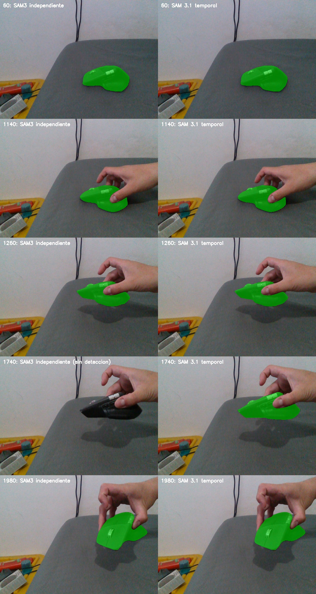

# SAM 3.1 instalado y evaluado en RTX 4070 Laptop

Se descargó el checkpoint oficial de **3.26 GiB** con la credencial local de
Hugging Face, se verificó su SHA256 y se instaló un entorno aislado Python 3.12,
PyTorch 2.7.1 CUDA 12.6. Código y reproducción:
[experiments/sam31](../experiments/sam31/README.md).

## Resultado

SAM 3.1 mantuvo una máscara en **161/161 frames** en las tres pasadas completas.
En las 20 imágenes con máscara SAM3 de referencia, la IoU media fue **0.9891**,
mínima **0.9797**. Se inspeccionaron visualmente las máscaras de frames 60, 1140,
1260, 1740 y 1980: mantienen el mouse durante movimiento y oclusión parcial de
la mano. En el frame 1740, SAM3 por imagen no había devuelto máscara y SAM 3.1
temporal sí. Esto es continuidad/acuerdo entre modelos, no precisión contra
ground truth ni garantía de ausencia de falsas detecciones.

| Configuración | Frames con máscara | Tiempo de propagación* | FPS* | Pico PyTorch |
|---|---:|---:|---:|---:|
| Buffer oficial 15 frames, pasada 1 | 161/161 | 69.883 s | 2.304 | 6422.7 MiB |
| Buffer oficial 15 frames, pasada 2 | 161/161 | 68.636 s | 2.346 | 6430.3 MiB |
| Buffer 0, pasada adicional | 161/161 | 66.396 s | 2.425 | 6418.6 MiB |

*Suma de tiempos de entrega del generador, excluyendo guardar cada resultado.
Incluye cómputo, postprocesado y esperas internas; no incluye cargar modelos,
leer imágenes inicialmente ni agregar el prompt. No son FPS del sistema completo.
No corrieron FoundationStereo ni FoundationPose durante esta medición.

El predictor oficial retiene 15 frames antes de entregar los primeros resultados:
la primera entrega de propagación tardó 6.324 s y 5.805 s respectivamente. Con
`--hotstart-delay 0` bajó a **0.381 s después del prompt**, sin cambiar las
estadísticas de máscaras de esta secuencia. En esa pasada, **el prompt inicial
tardó 1.479 s**, que debe sumarse para evaluar una interacción desde cero con
el modelo ya cargado. La pasada sin buffer conservó el ID 0 en todos los frames.
Quitar el buffer puede afectar los filtros temporales en otras escenas.

La continuidad es prometedora, pero ~2.4 FPS y ~6.3 GiB de memoria asignada solo
para segmentación dejan poco margen para correr profundidad y pose 6D en los
8 GiB de esta GPU. Se conserva como experimento, sin cambiar el backend del vivo.

## Condiciones y adaptaciones

- 161 RGB rectificados del replay FS4, frames 60–2460 con paso 15. Se guardaron
  como PNG sin pérdida. Es una secuencia submuestreada de la grabación, no todos
  los frames a 30 Hz ni una entrada de cámara en vivo.
- Texto `computer mouse`, máximo un objeto, multiplex 16, batch de grounding 1,
  imágenes en CPU, autocast BF16, tronco visual BF16 y resto del modelo FP32.
- 873,185,516 parámetros. Sin torch.compile ni FlashAttention 3. Decoder SDPA
  Efficient/Math por la limitación del wheel Windows. No se extrapola a Linux,
  otras GPU ni a las cifras oficiales de Meta.
- La carga final sobre el modelo completo tiene **cero claves faltantes y cero
  inesperadas**. `use_rope_real=False` evita buffers derivados de RoPE que no
  vienen en el checkpoint; conserva sus frecuencias complejas originales.
- Adaptador local para el argumento de sesión `offload_state_to_cpu=False` que
  la API base oficial pasa y el multiplex no acepta. No se modificó upstream.

La primera prueba FP32 produjo máscaras, pero rozó el límite de GPU (7890 MiB
observados con nvidia-smi) y presentó esperas largas; se interrumpió y se marcó
como incompleta en `sam31_video_v4_20261011/summary.json`. Convertir todo a BF16
falló porque las FFN del decoder desactivan autocast y requieren FP32. Convertir
solo el tronco visual permitió las tres pasadas completas anteriores.

Las ejecuciones iniciales fallidas quedan registradas en `sam31_video_20261011`,
`sam31_video_v2_20261011`, `sam31_video_v3_20261011` y
`sam31_video_bf16_20261011`; no se incluyen como benchmarks exitosos.

## Archivos de resultados

- [Dos pasadas completas](sam31_video_mixed_20261011/summary.json).
- [Pasada sin buffer temporal](sam31_video_no_delay_20261011/summary.json).
- Cada carpeta contiene las máscaras `.npy` y los RGB de entrada.
- Dependencias verificadas: 53 paquetes compatibles. Ambas ejecuciones completas
  terminaron con código 0. El código experimental compila correctamente.

La corrección de la caja solicitada se documenta por separado en
[caja_base_mouse_20261011.md](caja_base_mouse_20261011.md).
